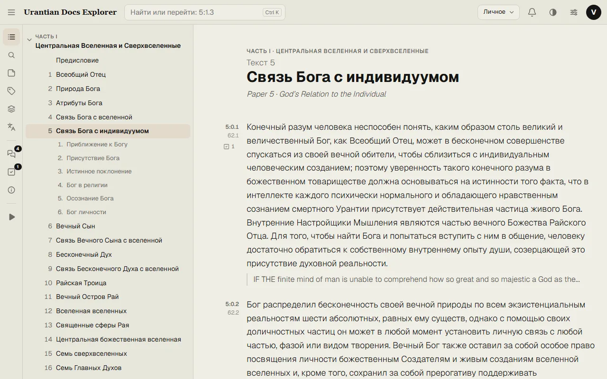
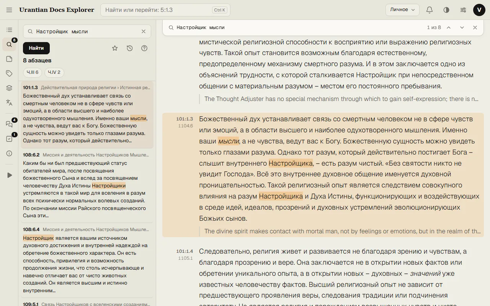
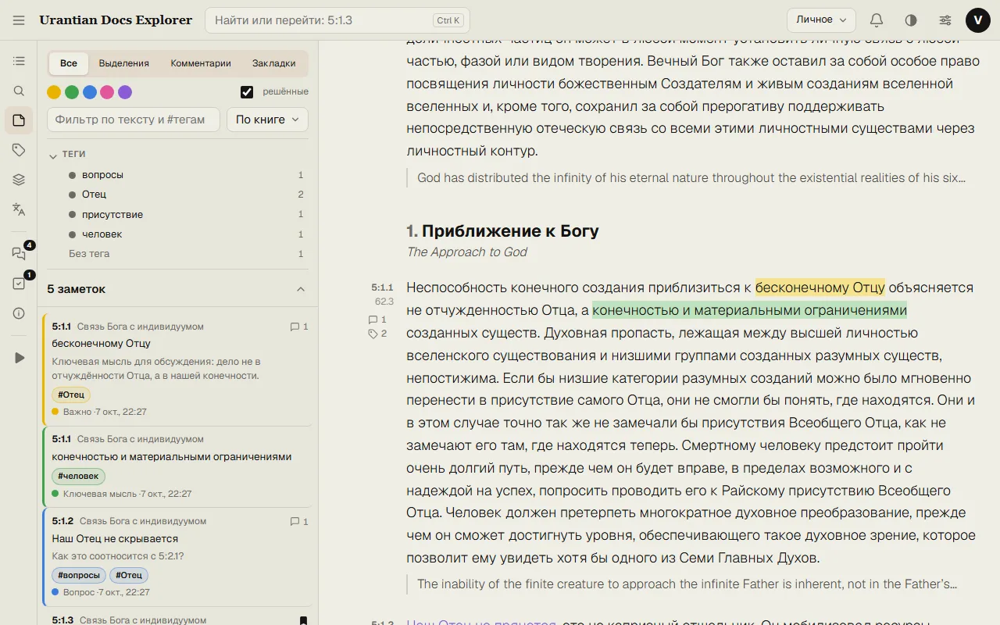
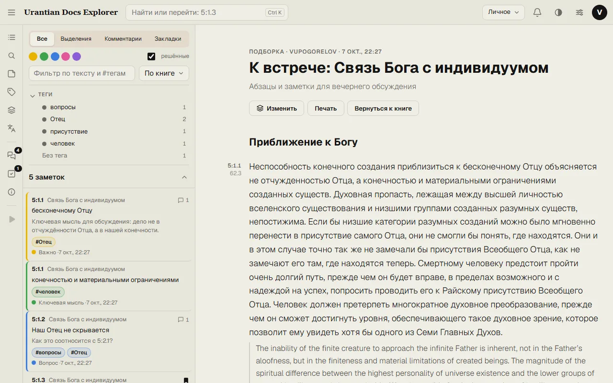
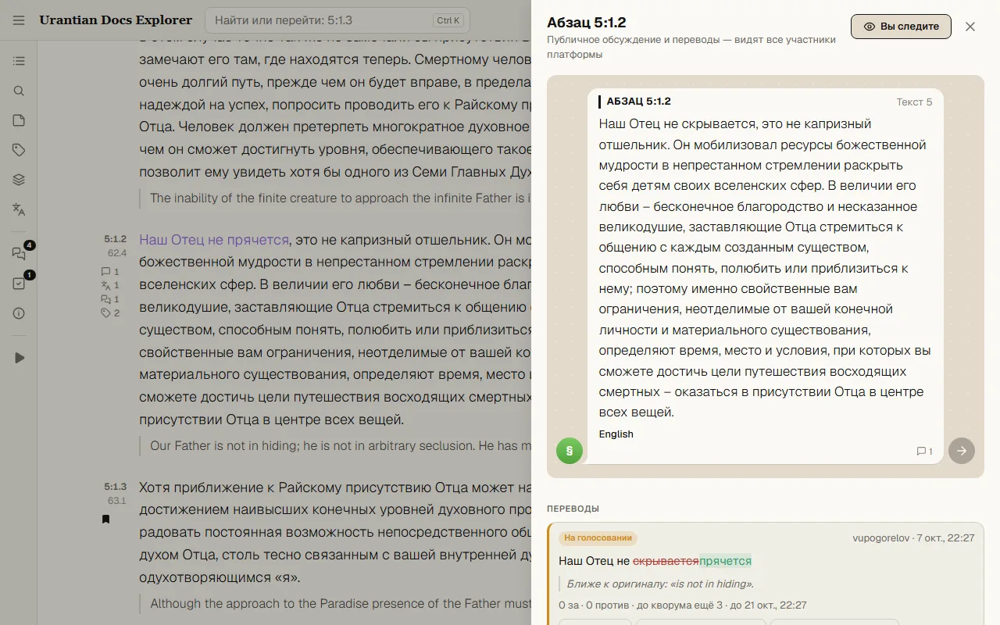
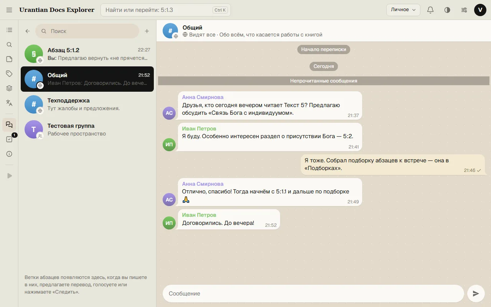
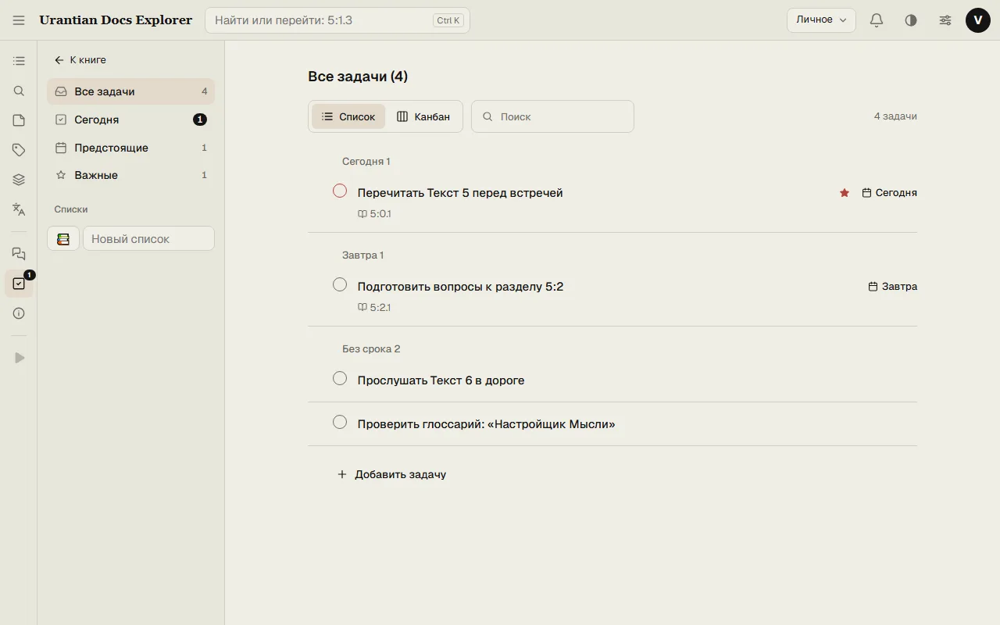
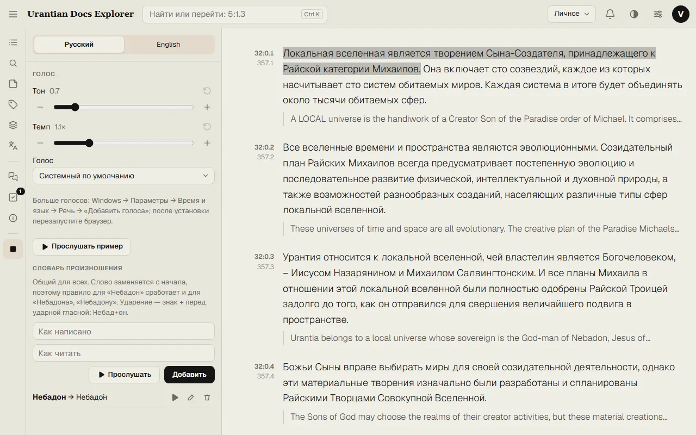
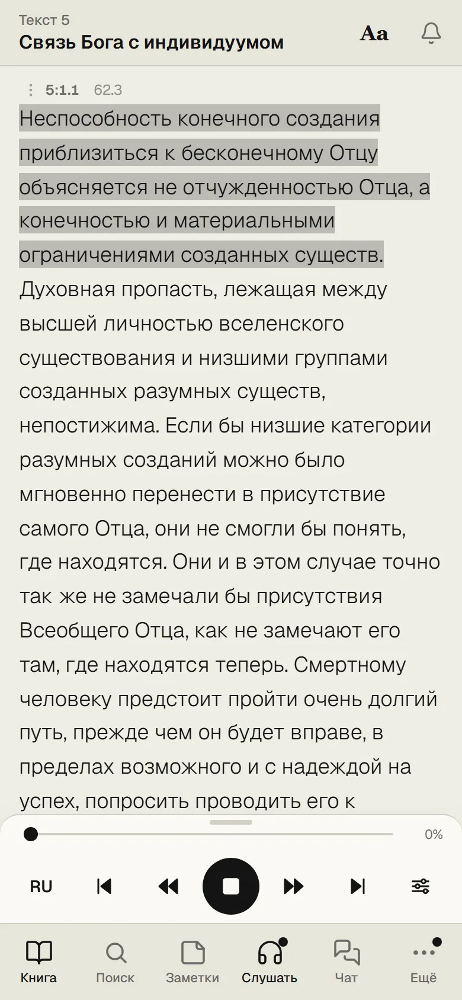

# Urantia Papers Explorer

Платформа для вдумчивого чтения и совместного изучения Книги Урантии — одна, своя, для нашей группы.

## Чтение

Читайте русский перевод Фонда Урантия рядом с английским оригиналом. Английский абзац можно держать раскрытым, свернуть в одну строку или скрыть совсем — как вам удобнее сверяться.

Английский текст — издание Uversa Press с его исправлениями и курсивом; он сам обновляется, когда в источнике что-то уточняют. *Text: the Uversa Press edition of The Urantia Book, [ubsite.ddns.net](https://ubsite.ddns.net/).*

У каждого абзаца есть номер и страница печатного издания: ссылку на любое место можно скопировать одним нажатием и отправить, а перейти к нужному месту — набрав «5:1.3» или «62.3» в строке вверху.

Подстройте чтение под себя: светлая или тёмная тема одним нажатием, шрифт, размер и толщина букв, межстрочный интервал и ширина колонки.

## Поиск

Находите нужное мгновенно. Ищете «любовь» — найдутся и «любви», и «любовью». Точная фраза — в кавычках, слова рядом друг с другом, начало слова, исключения и даже регулярные выражения для самых сложных случаев.

Ищите на обоих языках сразу, ограничивайте поиск частью книги или отдельными текстами и переходите от совпадения к совпадению прямо в тексте. Частые запросы сохраните — они всегда будут под рукой.

## Заметки

Отмечайте важное закладками: дайте закладке название, а выделенный фрагмент окрасьте цветом — и сами решайте, что значит каждый цвет: «важно», «вопрос», «ключевая мысль». Не придумали название — закладка возьмёт первые слова предложения. Группируйте заметки тегами с подтемами.

Оставляйте комментарии как в Google Документах — с ответами и отметкой «решено». Все заметки собраны в одном списке: закладки с фильтром по цвету, комментарии, теги и поиск по тексту.

Работайте в личном пространстве или вместе с группой: заметки общего пространства видят все его участники.

## Подборки

Соберите свой маршрут по книге: нужные абзацы, свои заметки и заголовки в удобном порядке — к встрече, докладу или для глубокой проработки темы.

Подборка читается как отдельный документ, её можно распечатать и показать другим: они смогут подписаться на неё или сделать себе копию.

## Перевод

Заметили неточность перевода — предложите свой вариант прямо в тексте и объясните, почему так точнее. Переводчики обсуждают и голосуют, а принятые варианты становятся новой редакцией.

Читайте как удобно: исходный перевод, новую редакцию или режим правки, где видно, что и как изменилось. Глоссарий подскажет, как принято переводить термины, а готовые решения можно выгрузить.

## Чат

Обсуждайте каждый абзац книги как пост в канале: текст абзаца с английским оригиналом сверху, комментарии участников под ним. Всё в привычном стиле мессенджера — ответы с цитатой, реакции, упоминания через @, и упомянутый получит уведомление.

Нажмите «Следить» у абзаца — и вы не пропустите новые сообщения и решения по нему, даже если сами ещё ничего не писали.

Для общих тем есть каналы, а для узкого круга — свои рабочие группы, чат которых видят только участники. У каждого чата значком показано, кто его читает, поэтому всегда понятно, где можно говорить свободно.

## Задачи

Записывайте задачи прямо по ходу чтения и привязывайте их к абзацам — вернуться к нужному месту можно одним нажатием.

Ставьте сроки, отмечайте важное, раскладывайте по своим спискам, дробите на подзадачи и смотрите списком или доской. Задачи на сегодня всегда видны на значке.

## Слушать

Слушайте книгу голосом своего устройства. Текущее предложение подсвечивается, а текст сам прокручивается следом — можно слушать и одновременно следить глазами.

Выберите голос, темп и тон — отдельно для русского и английского. Общий словарь произношения достаточно один раз научить правильно говорить «Небадон», и так будет звучать у всех.

## Телефон

Удобное мобильное приложение — устанавливается прямо из браузера, без магазина и скачивания. Читайте, слушайте и делайте заметки на ходу.

Плеер запоминает место и позволяет перемотать по всей книге, а включить и остановить чтение можно прямо из шторки уведомлений, не переключаясь между приложениями.

Книга работает и без интернета — в самолёте, в метро, на даче. После первого входа приложение само сохраняет на устройстве весь текст с поиском и глоссарием (около 7 МБ). Сообщения и заметки, написанные без связи, появляются сразу с часиками и уходят сами, когда связь вернётся.

Для Android есть отдельное приложение (меню «Ещё» → «Android приложение»): с ним книга читается вслух и при выключенном экране — голосом, установленным на телефоне.

## Доступ

Зарегистрироваться может каждый: создайте учётную запись на странице входа — и сразу получите роль участника со своим личным пространством. Расширенные роли назначает администратор. Возможности каждого участника определяются ролями двух уровней — на всей платформе и внутри рабочего пространства.

### Роли на платформе

**Участник**\
Читает книгу, ищет, ведёт заметки, подборки и задачи, слушает, пишет в каналах и обсуждениях абзацев. Он может предложить свой вариант перевода — пока это черновик, его видит только автор.

*Например, вы читаете Текст 5, отмечаете важные мысли закладками и предлагаете более точное слово в абзаце 5:1.2.*

**Переводчик**\
Вдобавок выносит свои варианты на голосование и голосует за чужие. Решение принимается, когда набирается кворум и нужная доля голосов «за».

*Например, переводчик сравнивает три варианта для 5:1.2 и голосует за тот, что ближе к оригиналу.*

**Координатор**\
Отвечает за порядок в общем пространстве: снимает предложения с голосования и отклоняет их, скрывает неуместные сообщения, создаёт каналы, ведёт глоссарий терминов и словарь произношения.

*Например, координатор закрепляет в глоссарии перевод «Thought Adjuster» и учит голос правильно произносить «Небадон».*

**Администратор**\
Приглашает новых участников, назначает роли, блокирует учётные записи и задаёт правила голосования: кворум, долю голосов и срок.

*Например, администратор приглашает нового человека и назначает его переводчиком.*

### Роли в рабочем пространстве

У каждого есть личное пространство, а для совместной работы можно создать групповое и пригласить в него людей.

**Читатель**\
Видит заметки, комментарии и подборки группы.

*Например, гость кружка заранее смотрит подборку к встрече и закладки ведущего.*

**Комментатор**\
Также участвует в обсуждении: комментирует текст, отвечает на комментарии и пишет в чат пространства.

*Например, участник кружка задаёт вопрос к закладке ведущего и обсуждает ответ в чате группы.*

**Редактор**\
Сам ведёт материалы группы: закладки с цветами и теги, подборки, сохранённые запросы и общие настройки пространства вроде названий цветов.

*Например, ведущий кружка готовит подборку к встрече и размечает ключевые места цветом и тегами.*

**Владелец**\
Управляет пространством целиком: приглашает и удаляет участников, назначает им роли, переименовывает и объединяет теги, переименовывает или удаляет само пространство.

*Например, организатор кружка создаёт пространство «Кружок по средам», приглашает участников и раздаёт им роли.*

## Приватность

Чтобы делать приложение удобнее, учитывается только время: сколько минут человек провёл в приложении, в каких разделах, сколько читал и слушал книгу. Содержание — что вы читаете, пишете и отмечаете — в этот учёт не входит. Сводку видит только администратор платформы.

Чтобы быстро находить и исправлять сбои, приложение ведёт короткий технический журнал: какие экраны открывались, какие кнопки нажимались, где сервер ответил с ошибкой или долго, что сломалось, есть ли связь, как работала озвучка. Тексты заметок, сообщений и поисковых запросов в журнал не попадают. Журнал хранится 30 дней, его видит только администратор.
